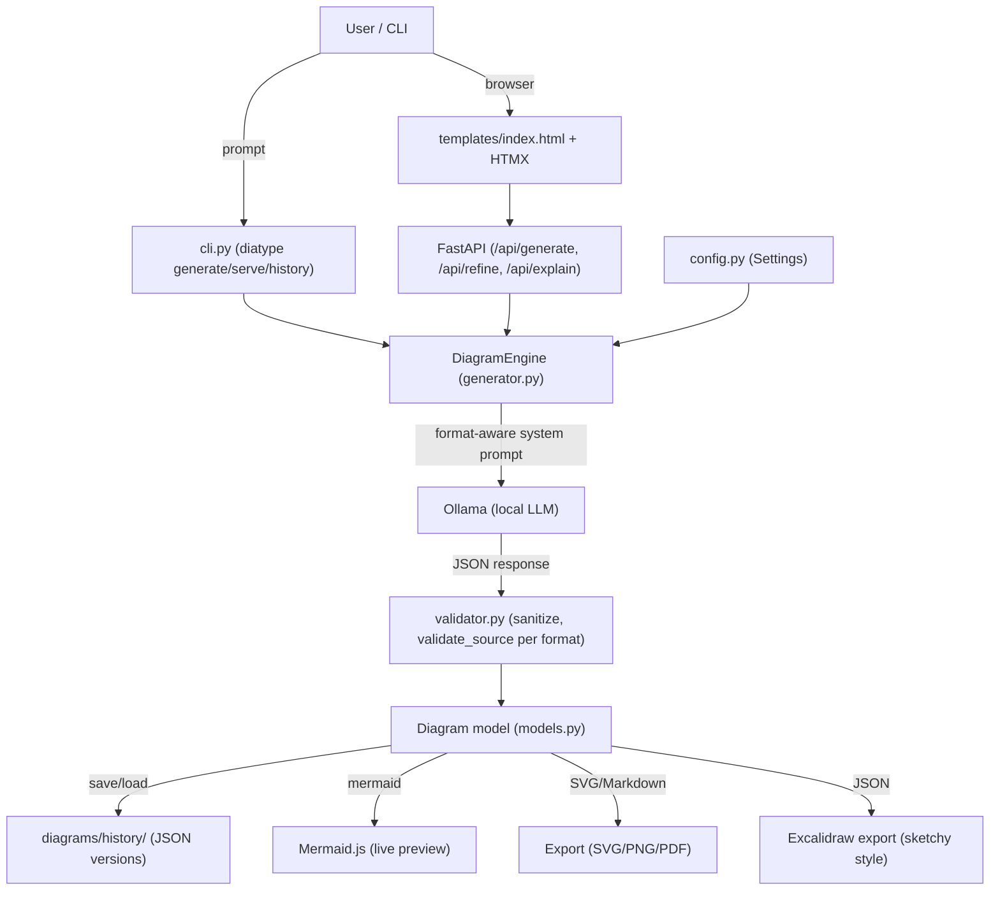

<!-- header:start -->
<div align="center">


<a href="#-quick-start"></a>

<a href="LICENSE"></a>

<a href="https://github.com/ajendras/diatype/stargazers"></a>
<a href="https://github.com/ajendras/diatype/actions/workflows/ci.yml"></a>

<a href="CONTRIBUTING.md"></a>

**Converts natural language into editable Mermaid diagrams with local LLMs inside a hand-drawn notebook interface**

[✨ Features](#-features) • [⚡ Quick start](#-quick-start) • [🧰 Usage](#-usage) • [🧩 Architecture](#-architecture) • [📍 Roadmap](#-roadmap) • [🤝 Contributing](#-contributing)

</div>
<!-- header:end -->

## ✨ Why DiaType?

Creating and updating technical diagrams is tedious and error-prone. Existing tools force you to learn complex syntax or send sensitive data to the cloud. DiaType lets developers, architects, and technical writers describe what they need in plain English, instantly receive valid Mermaid/PlantUML/Graphviz diagrams, and keep everything local, private, and version-controlled inside a delightful hand-drawn notebook interface.

- **Natural language to diagrams** — describe any process or structure and get clean, valid Mermaid, PlantUML or Graphviz via local Ollama
- **Iterative refinement** — tell the model to "add error handling" or "make the layout left-to-right" without rewriting prompts
- **Hand-drawn notebook UI** — lined paper, Caveat handwriting font, wobbly borders and highlighter accents create a familiar sketchbook feel
- **Zero cloud, fully editable** — live Mermaid preview, one-click SVG/PNG/PDF export, and CLI companion for scripts and CI

## 🎬 Demo

<p align="center"></p>

## 🚀 Features

<table>
<tr>
<td align="center" valign="top" width="33%">
🤖<br>
<b>Natural Generation</b><br>
Describe any diagram in plain English; receive valid Mermaid, PlantUML or Graphviz via Ollama (specialized prompts per format)
</td>
<td align="center" valign="top" width="33%">
📓<br>
<b>Notebook UI</b><br>
Handwriting-font headings, lined paper, wobbly borders and sticky notes
</td>
<td align="center" valign="top" width="33%">
🔄<br>
<b>AI Refinement</b><br>
Iterate with natural-language instructions; original structure is preserved
</td>
</tr>
<tr>
<td align="center" valign="top" width="33%">
👀<br>
<b>Live Preview</b><br>
Real-time Mermaid renderer updates as you edit the generated code
</td>
<td align="center" valign="top" width="33%">
📤<br>
<b>One-click Export</b><br>
Export as SVG, PNG, PDF, Markdown or Excalidraw JSON (sketchy hand-drawn style)
</td>
<td align="center" valign="top" width="33%">
🧩<br>
<b>Template Gallery</b><br>
Start from common patterns (architecture, user flows, sequence diagrams)
</td>
</tr>
<tr>
<td align="center" valign="top">
📝<br>
<b>Explanation Mode</b><br>
Ask the LLM to describe a diagram or suggest improvements in plain English
</td>
<td align="center" valign="top">
⌨️<br>
<b>CLI Companion</b><br>
Generate diagrams directly from terminal with <code>diatype generate</code>
</td>
<td align="center" valign="top">
📜<br>
<b>Versioned History</b><br>
Automatic file-based versioning; browse, reload any previous state from disk
</td>
</tr>
</table>

## 📦 Installation

**Requirements**: Python 3.10+, a running Ollama instance with a model such as `llama3.2`.

```bash
pip install diatype
diatype serve          # starts the notebook UI at http://127.0.0.1:8000
```

For development or to run tests:

```bash
pip install -e ".[dev]"
pytest
```

The CLI entry point `diatype` is automatically installed from `pyproject.toml`.

## ⚡ Quick start

```python
from diatype.config import Settings
from diatype.generator import DiagramEngine
import json

engine = DiagramEngine(Settings.load())
diagram = engine.generate(
    "User logs in via OAuth, then the API gateway routes to an order service backed by PostgreSQL",
    diagram_type="flowchart",
    output_format="mermaid"
)

print(diagram.to_markdown())
print("\nExplanation:", diagram.explanation)

# New: PlantUML support via dedicated LLM prompt
puml = engine.generate(
    "User authenticates with service then retrieves order",
    diagram_type="sequence",
    output_format="plantuml"
)
print("\nPlantUML:\n", puml.to_markdown())

# New: export with sketchy hand-drawn styling for Excalidraw
with open("login_flow.excalidraw", "w") as f:
    json.dump(diagram.to_excalidraw(), f, indent=2)

# History is automatically maintained
print("\n--- Recent history entries ---")
for entry in engine.list_history(limit=5):
    print(f"• {entry['title']} (v{entry['version']}) at {entry['created_at'][:16]}")
```

The returned `Diagram` object is guaranteed to contain validated syntax for the chosen format.

## 🧰 Usage

**CLI one-liner** (creates both `.mmd`/`.puml`/`.dot` and `.md` files):

```bash
diatype generate "microservice architecture with API gateway, auth and payment services" \
  --type flowchart --format mermaid --output diagrams/architecture --explain

# PlantUML or Graphviz via dedicated prompts
diatype generate "user login sequence" --type sequence --format plantuml --output diagrams/login
diatype generate "dependency graph of services" --type graph --format graphviz --output diagrams/deps
```

**Refining an existing diagram** (Python):

```python
from diatype.models import Diagram

original = engine.generate("simple login flow")
refined = engine.refine(
    original,
    "add error handling step and a retry loop"
)
print(refined.to_markdown())
```

**Diagram history & versioning**

Every generated or refined diagram is automatically saved as a versioned JSON file (including full metadata, source, explanation and prompt). History lives in `./diagrams/history/` (configurable via `config.toml`).

```python
# List recent diagrams
for entry in engine.list_history(limit=10):
    print(f"{entry['created_at'][:16]} | {entry['id']}_v{entry['version']} | {entry['title']}")

# Load a previous version
previous = engine.load_version("diag_20241001_120000", version=2)
if previous:
    print(previous.to_markdown())
```

**CLI history support**:

```bash
diatype history                    # list recent entries
diatype history --id diag_20241001_120000 --version 2
```

**Excalidraw export** (opens in Excalidraw with hand-drawn Virgil font and roughness):

```python
ex_json = refined.to_excalidraw()
# Save and open in https://excalidraw.com
```

**Explanation mode** (useful for documentation):

```python
explanation = engine.explain(refined)
print(explanation)
```

**Launching the web notebook** with custom host/port:

```bash
diatype serve --host 0.0.0.0 --port 8080 --reload
```

<details><summary>Advanced: using the FastAPI endpoints directly</summary>

```bash
curl -X POST http://127.0.0.1:8000/api/generate \
  -H "Content-Type: application/json" \
  -d '{"prompt": "sequence of a CI pipeline", "diagram_type": "sequenceDiagram", "format": "mermaid"}'
```

The `/api/refine`, `/api/explain`, `/api/excalidraw`, `/api/history` and `/api/load_version` endpoints are available. All routes are defined in `src/diatype/app.py`.
</details>

## 🔧 Configuration

DiaType loads settings from `config.toml` (or falls back to defaults). The `Settings` class in `src/diatype/config.py` exposes:

| Option                | Default                  | Description |
|-----------------------|--------------------------|-------------|
| `ollama_model`        | `llama3.2`               | Ollama model tag. Smaller instruction-tuned models work best. |
| `temperature`         | `0.2`                    | Lower values yield more deterministic diagram syntax (0.0-0.7). |
| `default_diagram_type`| `flowchart`              | One of the supported Mermaid kinds (validated by regex). |
| `default_format`      | `mermaid`                | Output format: mermaid (default), plantuml or graphviz. Uses additional tailored LLM prompts for the latter two. |
| `max_tokens`          | `2500`                   | Maximum tokens requested from the model. |
| `output_dir`          | `diagrams`               | Directory for exported files (created automatically). |
| `history_enabled`     | `true`                   | Whether to automatically save diagrams to versioned history. |
| `max_history`         | `30`                     | Maximum history files to retain (oldest pruned first). |
| `history_dir`         | `diagrams/history`       | Where versioned JSON files are stored. |

See `config.example.toml` for a ready-to-copy sample.

## 🧩 Architecture



`DiagramEngine` orchestrates prompt construction, LLM calls, parsing, validation and refinement. The FastAPI layer and CLI stay thin, delegating all intelligence to the engine. All generated diagrams are sanitised and validated before leaving the backend. The new `Diagram.to_excalidraw()` performs lightweight flowchart parsing into Excalidraw elements using hand-drawn styling (Virgil font + roughness=2). History uses simple timestamped JSON files with automatic pruning. PlantUML and Graphviz are supported via dedicated system prompts that instruct the LLM to emit the appropriate syntax inside the shared JSON schema (`source` + `explanation`).

## 📁 Project structure

```text
.
├── pyproject.toml                 # metadata, dependencies, CLI entry point
├── config.example.toml            # sample settings (ollama_model, temperature, etc.)
├── src/diatype/
│   ├── __init__.py                # public API: Diagram, DiagramEngine, DiagramRequest
│   ├── config.py                  # Settings Pydantic model with TOML loader
│   ├── models.py                  # Diagram & DiagramRequest with validators + to_excalidraw
│   ├── generator.py               # DiagramEngine (generate, refine, explain, history)
│   ├── validator.py               # validate_source (mermaid/plantuml/graphviz), sanitize, detect_diagram_type
│   ├── app.py                     # FastAPI routes + Jinja2 notebook UI
│   └── cli.py                     # Typer commands: generate, serve, history, version
├── templates/index.html           # hand-drawn notebook UI (Caveat font, lined paper)
├── static/
│   ├── css/styles.css             # wobbly borders, highlighter accents, sticky notes
│   └── js/main.js                 # HTMX interactions, mermaid rendering, exports
├── tests/test_generator.py        # pytest + mocked Ollama, snapshot tests
├── examples/demo.py               # runnable Python example (architecture diagram)
└── LICENSE
```

## 🧪 Testing

```bash
pytest
```

The test suite (`tests/test_generator.py`) covers `DiagramEngine.generate` (including new PlantUML/Graphviz paths), `refine`, `explain`, prompt validation, fallback JSON/markdown parsing, validator integration for all three formats, error handling, snapshot-style checks for common diagram outputs, the `Diagram.to_excalidraw()` method, and the history persistence, listing and loading behaviour. Ollama calls are fully mocked.

## 📍 Roadmap
<!-- roadmap:start -->
- [x] **v0.1.0** — first release: Natural Generation, Notebook UI, AI Refinement, Live Preview
- [x] Add Excalidraw JSON export with sketchy hand-drawn look
- [x] Implement diagram history with simple file-based versioning
- [x] Support PlantUML and Graphviz via additional LLM prompts
- [ ] Add voice input using whisper for diagram descriptions
- [ ] Create Obsidian plugin to insert generated diagrams
- [ ] Improve few-shot prompting for higher first-try accuracy
- [ ] Add bulk generation from a folder of markdown requirement files
- [ ] Support custom user-defined diagram templates
- [ ] Export directly to draw.io XML format
- [ ] Add WebSocket live collaboration for shared notebooks
- [ ] Provide browser extension to capture DOM structure and suggest matching diagrams
- [ ] Create sepia dark notebook theme variant

> 🤖 This roadmap is worked through continuously — ideas and PRs welcome!
<!-- roadmap:end -->

## 🤝 Contributing

We welcome contributions! Whether it's a new diagram template, improved prompts, UI polish, or better validation heuristics, every PR helps.

Please read [CONTRIBUTING.md](https://github.com/ajendras/diatype/blob/main/CONTRIBUTING.md) and follow our [CODE_OF_CONDUCT.md](https://github.com/ajendras/diatype/blob/main/CODE_OF_CONDUCT.md). Good-first-issues are tagged and make excellent starting points.

## 📄 License

DiaType is licensed under the **MIT License**. See [LICENSE](LICENSE) for the full text.

<!-- footer:start -->
<div align="center">

### ⭐ Star history

<a href="https://star-history.com/#ajendras/diatype&Date"></a>

If **DiaType** saves you time, a ⭐ helps others find it.

Made with ❤️ by [Ajendra](https://ajendra.info)


</div>
<!-- footer:end -->
